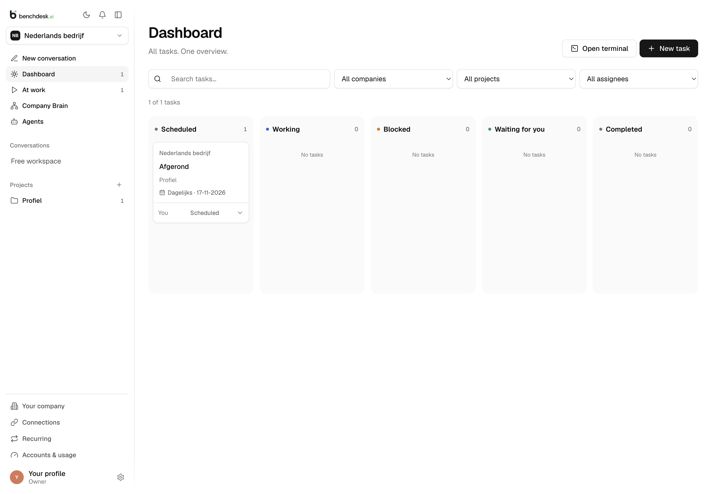
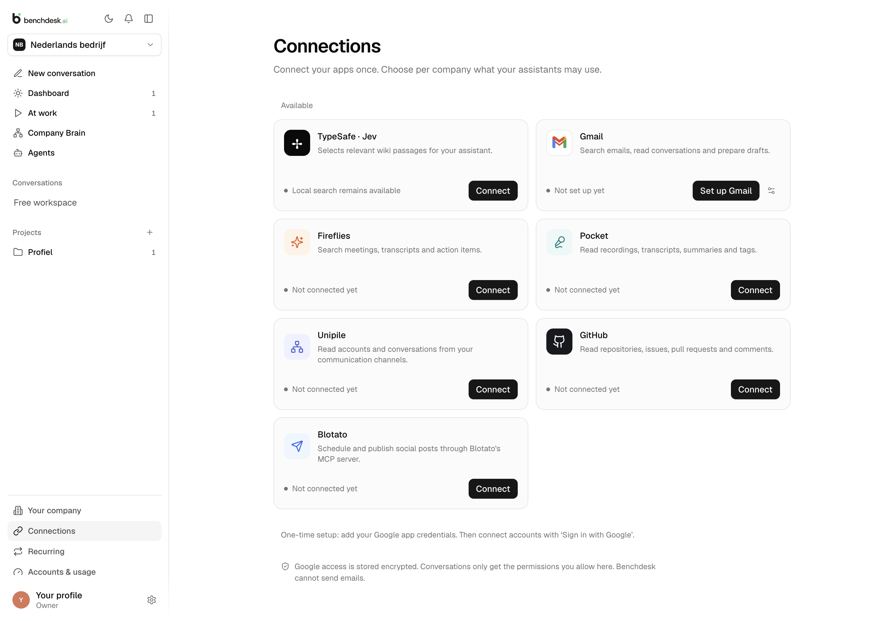

# Benchdesk

One desk for your companies, goals and tasks, with Claude Code, Codex and your terminal right next to them.

Benchdesk is a Mac app. Add a company, set a goal, describe a task and hand it to Claude Code or Codex. The assistant starts with the context of that company, works in its folder and reports back. You review the result and decide when the task is done.

It runs on your Mac. Benchdesk starts the CLIs you already have installed, with your own accounts, configuration and permission prompts.



> **Status:** early, and built for daily use by its maker. There is no signed download: you build it from source. Apple Silicon Macs only. The interface starts in Dutch; switch to English in your profile (bottom left) under **Taal**.

## What you get

- **Dashboard.** Every task across your companies on one board: scheduled, working, blocked, waiting for you, completed.
- **At work.** Conversations side by side on one canvas. Split, resize and see which one needs you. Every panel is a real terminal running Claude Code, Codex or your shell.
- **Tasks with criteria and review.** Assistants submit results for review. Only you mark work as done.
- **Notes per conversation.** What was done, what was decided, what is still open and the next steps. The assistant keeps them up to date; you can correct them or turn a next step into a task.
- **Agents.** Named agents with a role, a briefing, their own memory, skills and routines. Agents can hand work to each other, and every action passes rules you set, with an audit log.
- **Company Brain.** A local wiki per company. Assistants start a task with the relevant passages instead of a blank page. Changes are proposals until you accept them.
- **Connections.** Gmail (search, read and drafts, never send), GitHub, Fireflies, Pocket, Unipile and Blotato. Keys are stored encrypted on your Mac, and you choose per company what assistants may use.
- **Recurring.** A read-only overview of what runs on a schedule: crontab, launchd, Codex and Claude scheduled tasks, plus Instantly, Blotato, n8n and Hostinger through the MCP connections you already have.
- **Accounts & usage.** Several Claude and Codex accounts, a default per company, and how much usage each has left.
- **On your phone.** A mobile web app and a native iOS client to follow conversations and send messages, over your private Tailscale network.
- **Backups.** Export and restore your task data from the app.



## What you need

- A Mac with Apple Silicon.
- **Node.js 22 or newer** (developed on Node 24) and npm.
- **Xcode Command Line Tools** (`xcode-select --install`). The native modules `better-sqlite3` and `node-pty` are rebuilt for Electron during install.
- **Claude Code and/or Codex**, installed and logged in. Without them you still get the plain terminal.

## Quick start

```sh
git clone https://github.com/Arcgent/benchdesk.git && cd benchdesk
npm install
npm run dev
```

The first launch asks for a company name. After that, add the company's work folder, create a project and give your first task to an assistant.

On the first Codex conversation, Codex asks you to review new hooks. Open `/hooks` in the Codex terminal and review the Benchdesk hooks. They link the session status and conversation ID to the app. Benchdesk does not switch off the hook review and does not change your global configuration.

### Try it with sample data first

```sh
npm run web
```

Open http://localhost:5173. This browser preview uses its own sample data in `~/Library/Application Support/Werk-browser-preview` and leaves your desktop data alone. Use `npm run web:start` after an earlier build, and `WERK_WEB_PORT=5174` for another port. The server only listens on your Mac.

## Your data

- Companies, tasks, notes and agent chats live in a local SQLite database in `~/Library/Application Support/Werk` ("Werk" was the working name). Set `WERK_DATA_DIR` to use another folder.
- Your work files stay in your own folders. New files from an assistant go into the project folder, or the company folder if the project has none.
- Conversation transcripts and logins stay with Claude Code and Codex, as they do today. Account links in Benchdesk hold metadata only.
- Connection keys and Google tokens sit in an encrypted vault (AES-256-GCM), with the key protected by the macOS keychain.
- Benchdesk has no server of its own. It only talks to the services you connect, and to the usage endpoints of Claude and Codex to show what you have left.
- Backups contain file references, not copies of your work documents or CLI logins. Keep your work folders in your normal Mac backup.

## How it is built

| Folder | What it does |
| --- | --- |
| `src/electron` | Main process: window, menus, file pickers, keychain-protected vault key. |
| `src/runtime` | The background service ("runner") that owns every terminal and keeps them alive when the window closes. Also the `werk_task_context` MCP server that gives assistants task context and tools, the Claude and Codex hooks, the agent chat drivers, the policy gateway, connections and schedules. |
| `src/core` | SQLite store, backups, Company Brain, vault and preferences. |
| `src/shared` | Types, zod schemas and translations. Dutch is the source language; `locales/en.json` holds the English text. |
| `src/ui` | The React interface. |
| `src/web` | A local browser host for the same interface, used by the preview. |
| `src/mobile`, `ios/` | The phone bridge, the mobile web app and the native iOS client. |
| `tests/`, `scripts/` | Unit and integration tests, the build, and smoke tests that drive the real app. |

Closing or reloading the window leaves the runner and your terminals running. When a new version brings a newer runner, Benchdesk waits until existing conversations are closed before it replaces the old one. An update never stops working terminals on its own.

## Development

```sh
npm run dev            # build and start the desktop app
npm test               # unit and integration tests
npm run build          # type check and production build
npm run package        # release/mac-arm64/Benchdesk.app
```

`npm test` uses Electron as the Node runtime, so the native SQLite and PTY modules are tested with the same runtime as the app. It uses temporary data. No paid model calls are made and nothing touches your real Benchdesk data.

The smoke tests start the real app in a hidden window with temporary company data and fixture CLIs:

```sh
npm run test:today         # dashboard, filters, free terminal
npm run test:language      # English interface and language switch
npm run test:recurring     # recurring tasks
npm run test:schedules     # the Recurring overview with sample data
npm run test:computer      # computer use setup
npm run test:upgrade       # upgrade from an older runner
```

`npm run test:integrations` checks the Gmail connection with simulated accounts and needs an unlocked keychain.

Four older smoke tests (`test:ui`, `test:agents`, `test:colors` and `test:web`) currently fail on selectors that changed with the interface. They are kept as a starting point, and `npm run test:all` stops at the first of them.

### Building the app

`npm run package` builds the app and then checks its signature. It expects a code signing certificate named **Benchdesk Dev** in your keychain. A stable certificate matters: with an ad-hoc signature macOS treats every build as a new app and asks for folder access again after each install.

To use your own certificate, create a self-signed code signing certificate in Keychain Access (Certificate Assistant → Create a Certificate → type Code Signing) and put its name in `build.mac.identity` in `package.json`.

The app is not notarized, so it is meant for the Mac you build it on.

## More documentation

- [Agents and chat](docs/agents.md)
- [Gmail](docs/gmail.md)
- [Benchdesk on your phone](docs/mobile.md) and the [iOS client](ios/README.md)
- [Cron jobs and recurring work](docs/recurring.md)
- [Computer use](docs/computer-use.md)

## Made by

[Arcgent](https://arcgent.ai).
